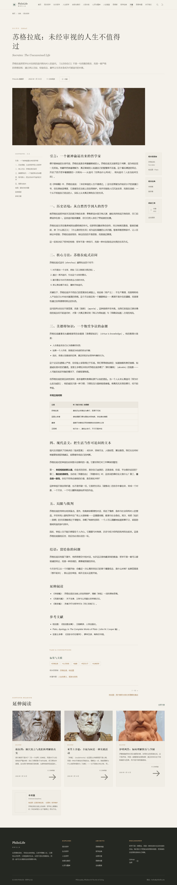
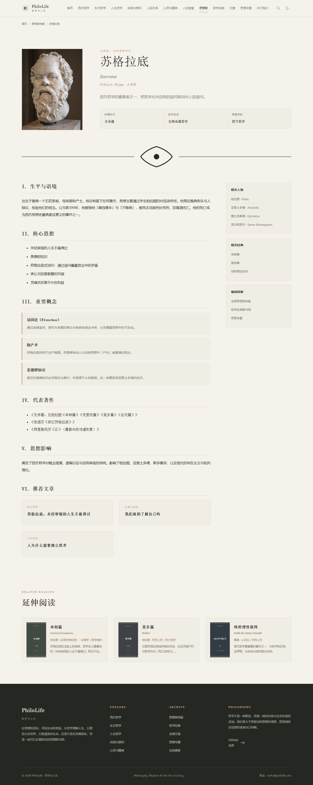
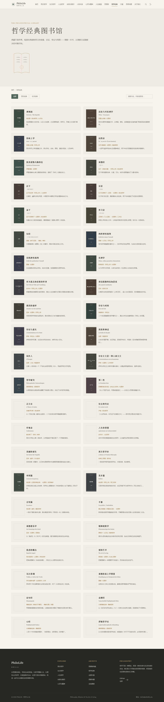

# PhiloLife · 哲学与人生

**Philosophy, Wisdom & The Art of Living**

> 在思想的深处，寻找生命的答案。
> 以哲学理解人生，以理性认识世界，以智慧面对生命。

PhiloLife 是一个中文哲学与人生智慧深度阅读平台。它不是哲学名言摘录站，不是心灵鸡汤网站，也不是普通博客——它试图同时成为一座**哲学数字图书馆**、一个**人生思想研究所**、一份**深度阅读杂志**、一部**哲学经典档案**与一套**思想家知识百科**。

---

## 一、项目介绍

本站围绕中西哲学传统与每个人都要面对的生命命题，提供有观点、有论证、有分歧的长篇文章与结构化知识档案。所有内容均为本站原创撰写，注重概念澄清、逻辑依据、不同立场的比较，以及对思想局限的批判性说明。

### 网站截图（真实浏览器截图）

| 页面 | 截图 |
| --- | --- |
| 首页（PC · 1440px） |  |
| 首页（手机 · 390px） |  |
| 文章详情 |  |
| 哲学家档案 |  |
| 经典书籍页面 |  |

以上截图由 agent-browser（Chromium）实际运行本站后截取，未使用任何虚构图片。

---

## 二、品牌理念

- **视觉气质**：古典哲学气质与现代中文思想杂志的结合；安静、克制、深沉、具有文学性。
- **主色**：主背景 `#F5F2EB`，卡片 `#EBE7DE`，主文字 `#292923`，品牌绿 `#52665B`，强调色 `#A17A50`。
- **字体**：中文正文使用系统无衬线字体栈，标题采用系统衬线字体栈；英文标题使用 Georgia 古典衬线字体。不依赖运行时远程字体加载。
- **设计原则**：大面积留白、细腻分割线、出版物式排版、罗马数字章节编号、克制的动效、无渐变与夸张阴影。

---

## 三、网站功能

- 独立首页 Hero 与每日哲思模块
- 37 篇深度中文哲学文章（含目录锚点、阅读进度、收藏、上下篇）
- 31 位中西哲学家档案
- 44 部哲学经典著作档案
- 6 个思想专题
- 7 大哲学分类页面
- 全站搜索（标题、关键词、摘要、哲学家、书名、标签）
- 文章分类筛选与标签筛选
- 思想家、书籍站内搜索
- 相关内容推荐
- 深色阅读模式（本地持久化）
- 收藏功能（localStorage）
- 移动端汉堡菜单与折叠目录
- 阅读时间显示、返回顶部
- SEO：独立标题、meta description、Open Graph、sitemap.xml、robots.txt、favicon.svg、结构化语义 HTML
- 可访问性：图片 alt、键盘可访问、清晰对比度、`prefers-reduced-motion` 支持

---

## 四、技术架构

| 项目 | 选择 |
| --- | --- |
| 构建工具 | Vite 6 |
| UI 框架 | React 18 |
| 语言 | TypeScript 5 |
| 样式 | 原生 CSS（无 UI 组件库） |
| 路由 | react-router-dom `HashRouter`（适配 GitHub Pages 子路径，刷新不 404） |
| Markdown | marked 15（本地解析，无运行时 API） |
| 内容管理 | 每篇文章独立 Markdown 文件 + Frontmatter；其余内容使用 TypeScript 数据模块 |
| 后端 / 数据库 | 无 |

直接依赖 9 个（4 个运行时 + 5 个开发依赖）；`npm install` 实际安装 75 个包。未引入大型 UI 框架、动画库、图表库或状态管理库。

---

## 五、页面列表

| 路由 | 页面 |
| --- | --- |
| `/` | 独立首页 |
| `/western-philosophy/` | 西方哲学 |
| `/eastern-philosophy/` | 东方哲学 |
| `/life-philosophy/` | 人生哲学 |
| `/self-and-consciousness/` | 自我与意识 |
| `/relationships/` | 人际关系与伦理 |
| `/mind-and-spirit/` | 心灵与精神 |
| `/wisdom/` | 人生智慧 |
| `/thinkers/` | 思想家档案 |
| `/thinkers/[slug]/` | 哲学家详情 |
| `/books/` | 哲学经典图书馆 |
| `/books/[slug]/` | 书籍详情 |
| `/articles/` | 文章列表 |
| `/articles/[slug]/` | 文章详情 |
| `/topics/` | 哲学专题 |
| `/topics/[slug]/` | 专题详情 |
| `/search/` | 搜索结果 |
| `/about/` | 关于我们 |
| `*` | 404 页面 |

由于使用 HashRouter，实际 URL 形如 `https://yuxinrun.github.io/philolife/#/articles/socrates-examined-life/`。

---

## 六、知识体系

- **西方哲学**：前苏格拉底、古希腊、中世纪、近代、德国古典、现代哲学
- **东方哲学**：儒家、道家、墨家、佛学与禅宗、宋明理学、印度哲学
- **人生哲学**：意义、幸福、自由、选择、责任、命运、死亡、孤独、时间、爱、痛苦、希望
- **自我与意识**：自我认知、自我意识、人格、身份、欲望、理性、情绪、意识
- **人际关系与伦理**：爱情、友情、信任、尊严、同情、宽容、正义、社会契约
- **心灵与精神**：内心平静、焦虑、痛苦、精神自由、接纳、韧性、生命体验
- **人生智慧**：独立思考、判断力、决策、克制、自律、修养、学习、成长
- **哲学经典**：中西印经典、伦理学、美学与现代著作
- **哲学专题**：意义、幸福、自由、孤独、死亡、爱

---

## 七、内容管理方法

- 文章：`src/content/articles/*.md`，一篇一文件，YAML 风格 Frontmatter 描述元数据，正文为标准 Markdown。
- 思想家：`src/content/thinkers.ts`，统一的 `Thinker` 数据结构。
- 书籍：`src/content/books.ts`，统一的 `Book` 数据结构。
- 专题：`src/content/topics.ts`，通过 slug 关联文章、思想家与书籍。
- 索引：`src/content/index.ts` 使用 `import.meta.glob` 自动收集文章，并按日期排序。

新增内容时，只需在对应数据文件中追加条目，无需修改页面组件。

---

## 八、项目目录结构

```text
philolife/
├── public/
│   ├── favicon.svg
│   ├── robots.txt
│   ├── sitemap.xml
│   └── images/               # hero / philosophers / articles / topics / books
├── scripts/
│   ├── build_assets.py       # 图片下载、压缩、封面生成与来源清单
│   └── build_sitemap.py      # 自动生成 sitemap
├── src/
│   ├── assets/svg/           # 原创 SVG 图形文件
│   ├── components/           # 布局、卡片、SVG 组件
│   ├── content/
│   │   ├── articles/         # 37 篇 Markdown 文章
│   │   ├── thinkers.ts
│   │   ├── books.ts
│   │   └── topics.ts
│   ├── data/                 # （内容已集中在 content/ 下）
│   ├── hooks/                # 主题、收藏、SEO Hook
│   ├── pages/                # 所有页面
│   ├── styles/global.css     # 品牌视觉系统
│   ├── types.ts
│   ├── App.tsx
│   └── main.tsx
├── docs/screenshots/         # 真实浏览器截图
├── .github/workflows/deploy.yml
├── image-sources.md          # 图片来源与授权清单
├── index.html
├── package.json
├── tsconfig.json
└── vite.config.ts
```

---

## 九～十二、本地运行

### 安装依赖

```bash
npm install
```

### 开发命令

```bash
npm run dev
```

默认监听 `0.0.0.0:5173`。

### 构建命令

```bash
npm run build
```

产物输出到 `dist/`。类型检查：

```bash
npm run typecheck
```

### 本地预览构建产物

```bash
npm run preview
```

---

## 十三、GitHub Pages 部署方法

1. 将代码推送到 GitHub 仓库 `yuxinrun/philolife` 的 `main` 分支。
2. 进入仓库 **Settings → Pages**。
3. **Build and deployment → Source** 选择 **GitHub Actions**。
4. 工作流文件 `.github/workflows/deploy.yml` 将在每次 push 到 `main` 时自动执行构建与部署。
5. 首次运行完成后，访问 <https://yuxinrun.github.io/philolife/>。

配置要点：

- `vite.config.ts` 使用 `base: './'`，保证图片、CSS 与 JS 在 `/philolife/` 子路径下正确解析。
- 使用 `HashRouter`，所有路由都是 `index.html#/path` 形式，直接访问或刷新任意页面都不会 404。
- GitHub Actions 使用官方 `configure-pages`、`upload-pages-artifact` 与 `deploy-pages` Action，并配置 `pages: write` 与 `id-token: write` 权限。
- `public/robots.txt` 与 `public/sitemap.xml` 会随构建产物一起发布。

---

## 十四～十六、图片来源与版权

- 所有图片都保存在项目本地，网站运行时不请求任何远程图片服务。
- 历史图像来自 Wikimedia Commons，逐张筛选仅使用标注为 **Public domain** 或 **CC0** 的文件。
- 每张贴图的原始作品名、作者、来源页面、授权类型与尺寸记录在 [`image-sources.md`](image-sources.md)。
- 书籍封面为使用 Pillow 程序化生成的原创设计，无第三方版权负担。
- 少数无法取得可靠公有领域素材的条目使用同类公有领域图像或统一风格的原创 SVG 替代，并已在素材清单中注明。
- 原创 SVG 位于 `src/assets/svg/`，React 版矢量组件位于 `src/components/Svgs.tsx`。

---

## 十七、新增文章方法

1. 在 `src/content/articles/` 新建 `your-slug.md`。
2. 复制以下 Frontmatter 模板并填写：

```markdown
---
slug: your-slug
title: 中文标题
englishTitle: English Title
excerpt: 文章摘要
category: 人生哲学
tags: 标签一 | 标签二 | 标签三
author: PhiloLife 编辑部
date: 2026-01-01
readTime: 10
cover: /images/articles/meaning.webp
coverAlt: 封面图片描述
thinkers: socrates | plato
books: republic | nicomachean-ethics
topics: meaning
---

## 引言

正文使用标准 Markdown。二级标题会自动进入文章目录。
```

3. 运行 `npm run build` 验证。列表页、分类页、搜索结果与相关推荐会自动更新。

---

## 十八、新增哲学家 / 书籍方法

- 在 `src/content/thinkers.ts` 的 `thinkers` 数组中追加一个 `Thinker` 对象，填写 `id`、`name`、`englishName`、`years`、`era`、`school`、`image`、`biography`、`coreIdeas`、`works`、`concepts`、`influence`、`related` 与 `articleSlugs`。
- 在 `src/content/books.ts` 的 `books` 数组中追加一个 `Book` 对象；封面图片按编号放在 `public/images/books/`，并在数据中指向对应路径。
- 重新运行 `python scripts/build_sitemap.py` 更新站点地图。

---

## 十九、后续开发计划

- 持续扩充文章至 100+ 篇，补充更多现代哲学与技术哲学议题。
- 增加按作者精选的专题阅读路径与可打印的阅读卡片。
- 为每篇文章补充结构化数据（JSON-LD Article / Book）。
- 增加基于本地索引的高级搜索（多条件组合、时间范围）。
- 完善数量统计的视觉化呈现与知识图谱交互。

---

## 当前状态

- 页面：19 个路由（含 404）
- 深度文章：37 篇
- 思想家档案：31 位
- 经典书籍：44 部
- 思想专题：6 个
- 本地图片：119 张（约 6.1 MB）
- SVG：17 个（12 个 React 组件 + 4 个静态 SVG + favicon）
- 构建：`npm run build` 成功
- 浏览器测试：桌面与手机端渲染正常，无控制台错误，搜索 / 收藏 / 深色模式 / 目录 / 汉堡菜单均可用
